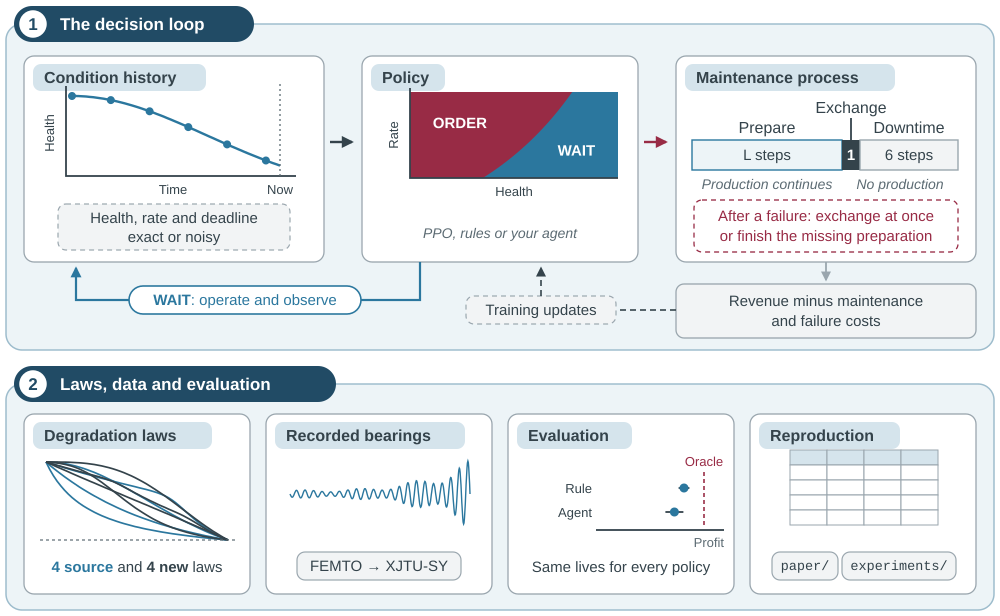
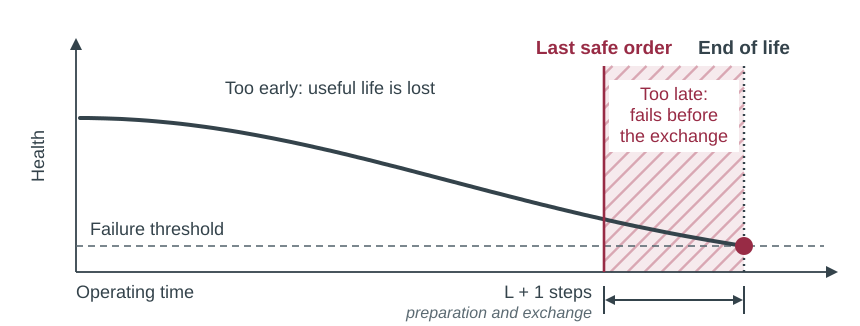
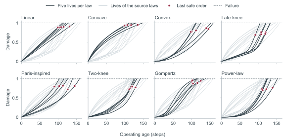
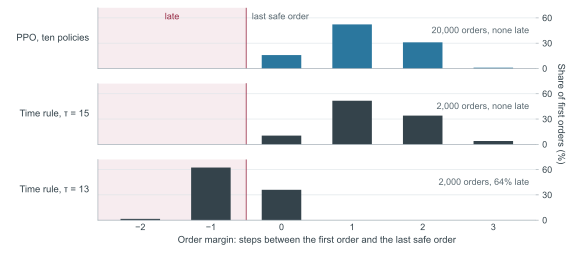
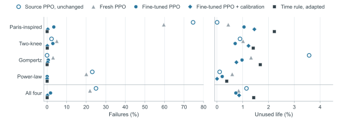
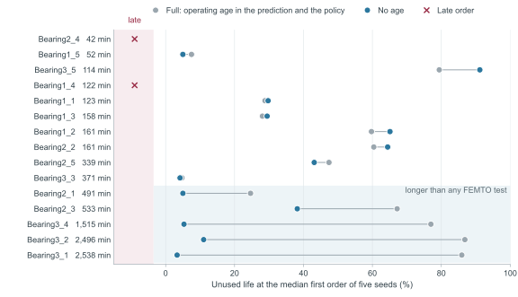

# MaintenanceArena

<p align="center">
  <strong>A simulator for learning when to order maintenance, with reinforcement learning, calibrated rules and a bearing replay.</strong>
</p>

MaintenanceArena is a simulator for learning when to order maintenance. A component earns
revenue while it degrades. An order starts the preparation of the replacement, and the component
keeps running until the preparation is done. An order that comes too late ends in a failure, and
one that comes too early gives away useful life. The policy sees the condition of the component
but never its lifetime.

This repository is the implementation accompanying the article:

> **Learning When to Act: What Reinforcement Learning Agents Learn about Maintenance Timing and
> When It Transfers**<br>
> Giuseppe Mannone, Paula Fischer and Martin Dazer, Institute of Machine Components (IMA),
> University of Stuttgart. Manuscript submitted for publication, 2026.

Version 1.0.0 · CPython 3.12 · Windows and Linux · MIT license



The policy reads the condition history of a component and chooses WAIT or ORDER (panel 1). An
order starts a preparation of *L* steps, followed by the exchange and six downtime steps. Revenue
minus maintenance and failure costs is the reward. The repository also provides eight degradation
laws, the bearing replay, a paired evaluation and the material of the article (panel 2).

## Contents

- [What this repository contains](#what-this-repository-contains)
- [The decision problem](#the-decision-problem)
- [What the article shows](#what-the-article-shows)
- [Install](#install) and [quick start](#quick-start)
- [Reproduce the article](#reproduce-the-article)
- [Environments](#environments)
- [Train and score your own agent](#train-and-score-your-own-agent)
- [Command line and run records](#command-line-and-run-records)
- [Documentation](#documentation) and [repository layout](#repository-layout)
- [Scope of 1.0.0 and roadmap](#scope-of-100-and-roadmap)
- [Citation](#citation), [license](#license), [acknowledgments](#acknowledgments) and
  [contributing](#contributing)

## What this repository contains

- Gymnasium environments for one component with preparation time, eight degradation laws and
  exact or noisy condition measurements
- PPO training and the DQN and double DQN learners that the article compares with it
- The Time rule of the article, further calibrated rules and an oracle for the evaluation
- A replay of the FEMTO and XJTU-SY bearing recordings with the remaining-time prediction, the
  risk classifier and the rule search
- Runners, configurations, seeds and saved outcomes that reproduce every results table of the
  article

## The decision problem



The core task follows one component from installation to its exchange. At each step the policy
chooses WAIT or ORDER. An order starts a preparation of *L* = 6, 12 or 24 steps, during which the
component keeps producing. One exchange step and six downtime steps follow. The last safe order
therefore lies *L* + 1 steps before the end of life, at a true remaining life of 13 steps for the
default *L* = 12. A later order ends in a failure, which costs 7,000 currency units (CU) on top of
the lost production. An earlier order is safe but gives away useful life.

The policy observes health, damage rate, a flag that marks a valid rate, and a deadline
coordinate. The coordinate is zero where the current rate projects the last safe order. It adds
no information, but it relates the condition to the preparation time. Measurements can be exact
or noisy, and noisy ones are reconstructed causally. In the default profile, every component
draws a lifetime between 96 and 160 steps and the shape of its degradation law.



All eight laws share one lifetime distribution and differ only in the path to failure. Damage
rises from zero at installation to one at failure, and the policy observes the health
*h* = 5<sup>−*d*</sup>. The four source laws train the policies, and the four new laws change when damage
accelerates. The laws reach the last safe order at different damage, and so at different health.
A good order therefore follows the remaining time, not a fixed health level.

In simple settings a well-calibrated threshold rule is already close to optimal. The article
therefore reads every learned policy against the Time rule, a threshold on the same projected
remaining time that is calibrated on separate lives. The rule shows what the supplied information
allows. It is a yardstick for what learning makes of that information, not an opponent. All
policies run on the same sampled components and are scored by cash per calendar step. In the
package the action ORDER is called REPLACE, and *L* is `mobilization_lead`.
[docs/GLOSSARY.md](docs/GLOSSARY.md) maps the notation of the article to the package.

## What the article shows

The article asks what a PPO agent learns about the timing of its orders, how that timing adapts
to changed degradation and what limits its transfer to new bearings. The figures below are drawn
from the saved first orders in [paper/](paper/README.md), so they show the stored results of the
article. `python tools/readme_figures.py` draws them again.

### PPO learns a margin of one step



On 2,000 test lives of the four source laws, the ten PPO policies order at the last safe step or
one to three steps earlier, with a median margin of one step. None of their 20,000 first orders
is late. No input prescribes this margin, so PPO learns it from the consequences of late orders.
A threshold at the projected deadline itself, τ = 13, has no margin and is late on 64% of the
lives. Calibrated on complete histories, the Time rule chooses τ = 15 and orders in the same
narrow band. It confirms the learned margin rather than competing with it. The median margin of
PPO stays at one step or less with preparation times of 6, 12 and 24 steps, with half or twice
the failure surcharge and after fine-tuning on the new laws.

The deadline coordinate makes this margin learnable within 204,800 training steps. With health
and rate alone, seven of ten runs never learned to order, although these inputs hold the same
information.

### Prior learning helps when degradation changes



The new laws keep the lifetime distribution but change when damage accelerates. Applied
unchanged, the source policies fail on 25% of the new lives, mostly where damage accelerates
late. Fine-tuning with 51,200 further steps brings the failures down to 1.76%. Fresh training
with the same budget still fails on 21.94%. With the full source budget of 204,800 steps, fresh
training also reaches timely orders and fails on 1.86%, so prior learning saves training rather
than giving a better final policy. The Time rule, recalibrated for each law, keeps a wider
margin. It fails even less often but leaves more life unused. With a calibrated threshold on
the ORDER probability, fitted on the same calibration lives as the rule, fine-tuned PPO +
calibration fails on 0.21% of the new lives, retains as much profit as the rule and leaves less
life unused.

### Operating age can mislead transfer



On recorded bearings, PPO combines a fixed remaining-time prediction with vibration indicators.
On held-out FEMTO bearings, PPO with operating age in the prediction and the policy (Full)
retains more profit than three references that use its inputs: 6.38 percentage points more than
its Time rule [0.74, 13.32], 7.26 more than a cross-validated search over sixteen threshold forms
[1.24, 14.48] and 7.01 more than a gradient-boosted risk classifier [2.40, 12.84], with 95%
intervals in brackets. The designs are trained on FEMTO, where every test ended within 468
minutes, and then applied unchanged to XJTU-SY. There the Full policies order the longest
bearings near the familiar FEMTO ages and give away most of their life. Without age, unused life
after transfer falls from 46.56% to 29.53%. The risk classifier with age orders near the FEMTO
ages as well, so the dependence is not specific to RL.

### Age misleads most when the condition inputs are imprecise

A controlled study in the simulator separates a longer lifetime, changed degradation and the
precision of the condition inputs. With exact health and rate, operating age moves the orders
only slightly when the lifetime doubles, and the orders still follow the last safe order. With
noisy health measurements, the deadline coordinate is less precise. Age then moves the orders
far earlier, by 17.75 percentage points of unused life at four times the lifetime, while it
lowers failures on the source lives. If the noise shrinks with the lifetime, so that the longer
lives are measured as precisely as the source lives, the effect without the filter stays as
large. The early orders thus come mainly from the longer lifetime itself.
`experiments/synthetic/age_shift.py` repeats this study.

## Install

MaintenanceArena runs on CPython 3.12 and is tested on Windows and Linux. Clone the repository
and install it into a virtual environment:

```bash
git clone https://github.com/SFZ-Uni-Stuttgart/MaintenanceArena.git
cd MaintenanceArena
python3 -m venv .venv
source .venv/bin/activate
python -m pip install -e .
```

On Windows, activate the environment with `.venv\Scripts\Activate.ps1` in PowerShell. If
PowerShell blocks the script, call `.venv\Scripts\python` instead of `python`.

The base install covers all environments, rules, planners, the evaluation and the benchmark.
Training needs the `rl` extra, the bearing replay the `bearings` extra and plotting the `plots`
extra. Install the CPU build of PyTorch first, otherwise pip pulls the much larger CUDA build:

```bash
python -m pip install --index-url https://download.pytorch.org/whl/cpu "torch==2.8.0+cpu"
python -m pip install -e ".[rl,bearings,plots]"
```

The files in `constraints/` pin the versions of the CI workflow, for example
`python -m pip install -c constraints/python312-linux-cpu.txt -e ".[rl,bearings,plots]"`.

## Quick start

```bash
python -m maintenance_arena list
python -m maintenance_arena simulate --profile paper-core-continuous-v1 --policy projection --seed 12001 --calendar-steps 240 --output outputs/first-cycle
python -m maintenance_arena evaluate --profile paper-core-continuous-v1 --policy reactive immediate age health projection --seed 12100 --episodes 32 --calendar-steps 240 --output outputs/core-rules
```

`list` prints the task profiles and the policies they accept. `simulate` follows one component
through wear, order, preparation, exchange and downtime, and writes every decision to
`outputs/first-cycle/decisions.csv`. `evaluate` runs five rules on the same 32 components. Its
summary gives, among other things, the mean profit per 1,000 calendar steps:

| Policy | Profit per 1,000 steps | Failures |
|---|---:|---:|
| `reactive`, run to failure | 182,574 | 32 |
| `immediate`, order at once | 124,474 | 0 |
| `age`, order at age 83 | 230,686 | 0 |
| `health`, order at health 0.36 | 231,276 | 0 |
| `projection`, the Time rule: order at a projected remaining time of 15 | 235,865 | 0 |

Each command writes into a new directory below `outputs/` and does not overwrite an existing one.
`examples/run_environment.py` runs all five profiles through the Python API.

The options of the article are configuration keys. This example selects the recovery used in the
article, in which completed preparation is kept after a failure, a preparation time of 24 steps,
the Gompertz law and the Health + rate input set:

```python
import maintenance_arena
from maintenance_arena.wrappers import InputSet

env = maintenance_arena.make("paper-core-continuous-v1", config={"env_config": {
    "recovery_contract": "preserve_preparation_v1", "mobilization_lead": 24, "family": "gompertz"}})
env = InputSet(env, "health_rate")
observation, info = env.reset(seed=0)
```

On the command line, `--config` takes the same overrides as a YAML or JSON file, for example
[examples/preserved_preparation.yaml](examples/preserved_preparation.yaml). An override gives the
profile a new identity, so its results stay separate from those of the published profile.
[docs/ENVIRONMENTS.md](docs/ENVIRONMENTS.md) lists all options.

## Environments

| Environment | Task |
|---|---|
| `maintenanceArena/CoreCycle-v0` | One component cycle, WAIT or REPLACE |
| `maintenanceArena/Gearbox-v0` | Normal or derated operation with continuing renewal, with exact dynamic programming as reference |
| `maintenanceArena/Resource-v0` | Maintenance jobs on three assets with spare parts, crews and shifts |
| `maintenanceArena/ResourceLifetime-v0` | The resource task with observed operating age |
| `maintenance_arena.banks.ScenarioBankEnv` | The core task on a finite bank of lives, as in the article |
| `maintenance_arena.bearings.BearingReplayEnv` | Recorded bearing histories, one decision per minute |

`import maintenance_arena` registers the four Gymnasium IDs. The bank and bearing environments
need a bank or prepared data and are created directly. Five frozen profiles fix the configuration
of each task and the settings of its baselines: `paper-core-continuous-v1`,
`paper-core-discrete-v1`, `paper-gearbox-v1`, `paper-resource-v1` and
`paper-resource-lifetime-v1`. [docs/ENVIRONMENTS.md](docs/ENVIRONMENTS.md) documents
observations, actions, rewards and `info` keys. It also covers what to watch for with RL
libraries, such as discounting in the gearbox and action masks in the resource tasks.

## Train and score your own agent

Any Gymnasium-compatible library works. With Stable-Baselines3 from the `rl` extra:

```python
import gymnasium as gym
import maintenance_arena  # registers the maintenanceArena/* IDs
from stable_baselines3 import PPO

env = gym.make("maintenanceArena/CoreCycle-v0")
model = PPO("MlpPolicy", env, gamma=0.999, seed=0, device="cpu")
model.learn(total_timesteps=50_000)


def my_agent(observation, info):
    return int(model.predict(observation, deterministic=True)[0])  # 0 = WAIT, 1 = REPLACE
```

A benchmark track fixes the test components, the references and the rule calibration, so all
results on a track are paired. One call scores an agent on the default track:

```python
from maintenance_arena import benchmark

print(benchmark.run_track("core-continuous-v1", my_agent).to_markdown())
```

On the command line the agent is imported as `module:callable`, here the hand-written agent of
the example script:

```bash
python -m maintenance_arena benchmark --track core-continuous-v1 --agent examples.benchmark_your_agent:deadline_agent --output outputs/track-core-agent
```

The harness passes the agent the observation and the public `info`, nothing else. Without an
agent, the command scores only the references:

```bash
python -m maintenance_arena benchmark --track core-continuous-v1 --output outputs/track-core
```

This takes about a minute on a CPU, and a rerun reproduces its `benchmark.md` byte for byte:

<!-- default-track-summary:begin -->
| Policy | Kind | Information | Profit per 1,000 calendar steps | % of oracle | Failures per 1,000 lives | Order margin mean (sd) | Late orders |
|---|---|---|---:|---:|---:|---:|---:|
| `oracle` | privileged reference | true lifetime (evaluator side) | 236,517.2 | 100.00 | 0.0 | 0.00 (0.00) | 0.0% (0/1000) |
| `projection` | built-in | observation | 236,336.4 | 99.92 | 0.0 | 1.30 (0.71) | 0.0% (0/1000) |
| `health` | built-in | observation | 232,014.9 | 98.10 | 0.0 | 26.28 (20.61) | 0.0% (0/1000) |
| `age` | built-in | operating age | 230,686.3 | 97.53 | 0.0 | 32.18 (13.87) | 0.0% (0/1000) |
| `reactive` | built-in | none | 184,348.1 | 77.94 | 1,000.0 | n/a | n/a |
| `immediate` | built-in | none | 124,473.7 | 52.63 | 0.0 | 115.18 (13.87) | 0.0% (0/1000) |

- Rule thresholds: age 83 (calibrated), health 0.36 (calibrated), projection 15 (calibrated).
<!-- default-track-summary:end -->

Profit is cash per 1,000 calendar steps, pooled over the 1,000 test components. The oracle knows
each lifetime and orders at the last safe order. It is an upper bound that only the evaluator can
compute. The rules use thresholds calibrated on 800 separate lives. An agent that acts on the
observation is best read against `projection`, the Time rule of the article, which uses the same
information. The tracks use the package defaults, so these numbers are not results of the
article. [docs/BENCHMARK.md](docs/BENCHMARK.md) gives the paired differences with bootstrap
intervals and the other four tracks. It also describes the recommended protocol: at least five
training seeds per agent, tuning only on calibration lives, and a note of any privileged
information used in training.

## Reproduce the article

The article can be reproduced at three depths.

The quickest check rebuilds its five data tables and four additional tables from the saved
outcomes. It needs only the standard library and takes seconds:

```bash
python paper/rebuild_tables.py --check
```

[paper/](paper/README.md) holds the step of the first order and the last productive step of every
evaluated life or bearing, for every method and trained run. It also holds the configurations,
seeds, fold assignments and selected thresholds. The script recomputes the tables and compares
them with the stored table files. `paper/order_margins.py` and
`paper/transfer_split.py` compute the order margins and the transfer split quoted in the text.
The data figures of this README come from the same files, and `python tools/readme_figures.py`
draws them with the `plots` extra.

The synthetic experiments need the `rl` extra but no data, because every life is rebuilt from its
seed:

```bash
python experiments/synthetic/source_learning.py --output outputs/synthetic/source --jobs 10
python experiments/synthetic/input_sets.py --output outputs/synthetic/input-sets --jobs 30
python experiments/synthetic/preparation_time.py --output outputs/synthetic/preparation --jobs 30
python experiments/synthetic/adaptation.py --source outputs/synthetic/source --output outputs/synthetic/adaptation --jobs 40
python experiments/synthetic/measurement_noise.py --source outputs/synthetic/source --output outputs/synthetic/noise --jobs 10
python experiments/synthetic/benchmarks.py --source outputs/synthetic/source --output outputs/synthetic/benchmarks
python experiments/synthetic/learner_comparison.py --output outputs/synthetic/learners --jobs 30
```

They take about 39 minutes on a 48-thread workstation. The candidate designs of the noise study,
their selection and the data of the synthetic figures take about 24 minutes more:

```bash
python experiments/synthetic/measurement_noise.py --stage development --source outputs/synthetic/source --output outputs/synthetic/noise-designs --jobs 24
python experiments/synthetic/measurement_noise.py --stage selection --development outputs/synthetic/noise-designs --output outputs/synthetic/noise-selection
python experiments/synthetic/figures.py --output outputs/synthetic/figures --source outputs/synthetic/source --input-sets outputs/synthetic/input-sets --preparation outputs/synthetic/preparation --adaptation outputs/synthetic/adaptation --plots
```

`experiments/synthetic/age_shift.py` trains PPO without and with operating age and tests it on
twins of the test lives with doubled or quadrupled lifetime, with exact or noisy health and with
noise that shrinks with the lifetime. It repeats the controlled test of the age input in
Section 6.5 and Appendix D:

```bash
python experiments/synthetic/age_shift.py --output outputs/synthetic/age-shift --jobs 20
python experiments/synthetic/age_shift.py --setting filtered --exact outputs/synthetic/age-shift --output outputs/synthetic/age-shift-filtered --jobs 20
python experiments/synthetic/age_shift.py --setting raw --exact outputs/synthetic/age-shift --output outputs/synthetic/age-shift-raw --jobs 20
python experiments/synthetic/age_shift.py --setting raw --scaled-noise --policies outputs/synthetic/age-shift-raw --exact outputs/synthetic/age-shift --output outputs/synthetic/age-shift-raw-scaled
```

`experiments/synthetic/failure_cost.py` trains the source policies again with half and twice
the failure cost (Section 4.1 and Appendix C):

```bash
python experiments/synthetic/failure_cost.py --output outputs/synthetic/failure-cost --jobs 20
```

The bearing experiments need the recorded data described below and the `rl` and `bearings`
extras:

```bash
python experiments/bearings/prepare_statistics.py --data-root DATA --check
python experiments/bearings/run_femto_cross_validation.py --data-root DATA --output outputs/bearings-femto --jobs 12
python experiments/bearings/run_transfer.py --data-root DATA --output outputs/bearings-transfer --jobs 12
```

The FEMTO cross-validation with 75 PPO fits takes about 37 minutes with 12 processes, the
transfer to XJTU-SY about 10 minutes. [experiments/README.md](experiments/README.md) lists all
runners, including the age designs, the Time rule on bearings, the candidate selection with its
nested check, the rule search and the risk classifier. [docs/GLOSSARY.md](docs/GLOSSARY.md) shows where each part of the method of the article
lives in the package.

The experiments were rerun on Windows with CPython 3.12.9, NumPy 2.4.2, PyTorch 2.8.0 (the CUDA
12.8 build, run on the CPU), scikit-learn 1.8.0 and pandas 2.3.0. Every rerun reproduced the
stored results of the article bit for bit, on the synthetic lives and on both bearing datasets.
Other platforms or library builds, including the CPU wheel above, can change the last digits of a
fit and with them the trained policies.

### Recorded bearing data

The bearing study replays two public run-to-failure datasets. They are not part of the
repository and have to be downloaded from their providers:

- FEMTO (PRONOSTIA, IEEE PHM 2012 Prognostic Challenge, FEMTO-ST Institute, Besançon): entry 10,
  "FEMTO Bearing", of the
  [NASA Prognostics Center of Excellence Data Set Repository](https://www.nasa.gov/intelligent-systems-division/discovery-and-systems-health/pcoe/pcoe-data-set-repository/),
  archive <https://phm-datasets.s3.amazonaws.com/NASA/10.+FEMTO+Bearing.zip>.
- XJTU-SY (Xi'an Jiaotong University and Changxing Sumyoung Technology): the download mirrors
  listed at <https://github.com/WangBiaoXJTU/xjtu-sy-bearing-datasets>.

Extract the archives, including any archive inside them, and place the folders below one data
root:

```text
DATA/
  FEMTO/
    Learning_set/Bearing1_1/acc_00001.csv ...     (6 bearings)
    Full_Test_Set/Bearing1_3/acc_00001.csv ...    (11 bearings)
  XJTU-SY/
    35Hz12kN/Bearing1_1/1.csv ...                 (5 bearings)
    37.5Hz11kN/Bearing2_1/1.csv ...               (5 bearings)
    40Hz10kN/Bearing3_1/1.csv ...                 (5 bearings)
```

`prepare_statistics.py --check` lists the bearings and acquisitions it finds and names anything
that is missing. With `--femto-dir` and `--xjtu-sy-dir` you can point to the folders where they
already are. The first run reads the raw files once and stores compact vibration statistics,
which all later steps use. [docs/BEARINGS.md](docs/BEARINGS.md) describes the file formats, the
processing and how to cite both datasets.

## Command line and run records

`python -m maintenance_arena`, or `maintenance-arena`, has the commands `list`, `tracks`,
`simulate`, `evaluate`, `benchmark`, `calibrate` and `train`, and `--help` describes each of
them. [docs/WORKFLOWS.md](docs/WORKFLOWS.md) shows paired evaluation, rule calibration, noisy
observations, training and resumption.

Every command and every experiment runner writes a `run.json` into its new output directory. It
records the command, the configuration and its hash, versions, seeds, input hashes, runtime and
status. `evaluate` and `benchmark` also write a `fixture.json`, with which further policies can be
scored on the same scenarios. Trained models are bound to their environment configuration,
training recipe and observation contract. [provenance.json](provenance.json) records the SHA-256
of every runtime file of this release.

## Documentation

- [docs/ENVIRONMENTS.md](docs/ENVIRONMENTS.md): environments, observations, rewards, degradation laws and scenario banks
- [docs/BEARINGS.md](docs/BEARINGS.md): bearing data, their processing, the replay and the bearing policies
- [docs/WORKFLOWS.md](docs/WORKFLOWS.md): simulation, evaluation, rule calibration and training
- [docs/BENCHMARK.md](docs/BENCHMARK.md): benchmark tracks, metrics and protocol
- [docs/GLOSSARY.md](docs/GLOSSARY.md): notation of the article and names in the package
- [docs/EXTENDING.md](docs/EXTENDING.md): new tasks, observations, policies and learners
- [experiments/README.md](experiments/README.md) and [paper/README.md](paper/README.md): experiments and saved outcomes of the article

## Repository layout

```text
src/maintenance_arena/   the package: environments, laws, banks, rules, evaluation, benchmark
  bearings/              bearing replay: data interface, features, prediction model, PPO, rules
  learning/              PPO, DQN, the bank trainers, MaskablePPO recipes, checkpoints
  data/                  frozen task profiles and benchmark tracks
experiments/             runners and configurations of the experiments of the article
paper/                   saved outcomes and the rebuild of the tables of the article
docs/                    documentation and the figures of this README
examples/                runnable examples and configuration overrides
tests/                   test suite (pytest)
tools/                   release checks, source export, track generation and README figures
constraints/             pinned dependency versions of the CI workflow
```

## Scope of 1.0.0 and roadmap

Version 1.0.0 contains everything the article uses: the core task with preparation times of 6,
12 and 24 steps, both recoveries after a failure, eight degradation laws, simulated measurement
noise, input sets and scenario banks, the bearing replay, PPO and the two learners compared with
it, the rule baselines with their calibrations, the risk classifier, the evaluation and the
runners of all experiments, including the controlled test of the age input, the failure-cost
study and the nested design choice on FEMTO. It also contains the gearbox and resource tasks
with their planners.

Not included yet are other preparation times, further datasets and condition estimates, shared
resources and maintenance windows across several components, and trained policies for download.
The runners train all policies again. The bearing transfer covers one pair of datasets, FEMTO
and XJTU-SY, and further bearing populations are a natural next test.
[CHANGELOG.md](CHANGELOG.md) describes the releases.

## Citation

If you use MaintenanceArena, please cite the accompanying article:

> G. Mannone, P. Fischer and M. Dazer. Learning When to Act: What Reinforcement Learning Agents
> Learn about Maintenance Timing and When It Transfers. Manuscript submitted for publication, 2026.

```bibtex
@unpublished{mannone2026learning,
  author = {Mannone, Giuseppe and Fischer, Paula and Dazer, Martin},
  title  = {Learning When to Act: What Reinforcement Learning Agents Learn about Maintenance Timing and When It Transfers},
  note   = {Manuscript submitted for publication},
  year   = {2026}
}
```

[CITATION.cff](CITATION.cff) holds the same reference for the "Cite this repository" button on
GitHub. It will be updated when the article is published. If you use the bearing replay, please
also cite the FEMTO and XJTU-SY datasets as listed in [docs/BEARINGS.md](docs/BEARINGS.md#sources).

## License

MaintenanceArena is released under the [MIT License](LICENSE), copyright (c) 2026 Giuseppe
Mannone, Paula Fischer and Martin Dazer. It may be used, changed and shared freely. Publications
that use it should cite the article above. Its dependencies and their licenses are listed in
[THIRD_PARTY_NOTICES.md](THIRD_PARTY_NOTICES.md). The bearing datasets
are not part of this repository and come with the terms of their providers.

## Acknowledgments

This work was funded by the Deutsche Forschungsgemeinschaft (DFG, German Research Foundation),
project number 532373244.

## Contributing

Questions, bug reports and benchmark results are welcome in the
[issue tracker](https://github.com/SFZ-Uni-Stuttgart/MaintenanceArena/issues).
[CONTRIBUTING.md](CONTRIBUTING.md) describes the development setup and the tests, and
[docs/EXTENDING.md](docs/EXTENDING.md) explains which changes need a new task identity.
Participation follows the [Code of Conduct](CODE_OF_CONDUCT.md). Please report security problems
privately as described in [SECURITY.md](SECURITY.md), which also explains why you should load
saved models only from trusted sources.
